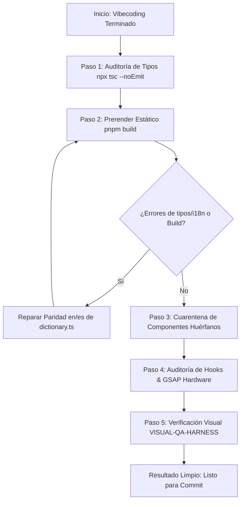

# 🧹 Build & Clean Protocol (Hardening & Purga)

> **Qué es:** El protocolo maestro de estabilización, compilación y limpieza arquitectónica para ejecutar durante o al finalizar cualquier sesión de desarrollo rápido de UI.
> **Cuándo usarlo:** Invícalo cada vez que termines de crear o modificar componentes, cuando el compilador o el navegador lancen errores de hidratación/i18n, o antes de enviar cambios a producción (`git commit`).
> **Objetivo:** Permitirte iterar a máxima velocidad creativa sin acumular deuda técnica, componentes huérfanos, errores silenciosos de i18n (`dictionary.ts`) o fugas de rendimiento en GSAP/React 19.

---

## 0 · Las 5 Leyes del Hardening en Portfolio 2026

1. **Data Parity Rule (cero texto huérfano):** Todo texto renderizado sale de `src/lib/dictionary.ts` vía `useLanguage()`, con llaves IDÉNTICAS en los objetos `en` y `es` — TypeScript fuerza la paridad al compilar (si `es` no satisface el tipo de `en`, el build falla). Cero texto quemado en JSX (incluidos `alt` y `aria-label`).
2. **Pureza de Render (React 19 / Next.js 16):** Cero llamadas impuras en el render (`Math.random()`, accesos directos a `window`/`document` fuera de `useEffect`/`useLayoutEffect`).
3. **Purga con Cuarentena:** Cualquier variante de prueba (ej. `SectionVariantA.tsx`, `HeroTest.tsx`) que no esté importada activamente en una ruta de `src/app/` se mueve a `_quarantine/` — **no se borra** (acuerdo TASTE-LEDGER §3.4).
4. **Disciplina Hardware Symphony (GSAP & Lenis):** Todo trigger o animación debe vivir dentro de un `gsap.context` con `ctx.revert()` en el cleanup. Scroll programático por `window.__lenis?.scrollTo(...)` o ScrollToPlugin de GSAP (`autoKill: false`, patrón shipped). NUNCA re-inicializar Lenis ni usar `window.lenis` (reservado por la librería).
5. **Zero Arbitrary Values (Zero-Px Policy):** Todo color, tipografía y espaciado debe provenir de los tokens de `src/styles/globals.css` y `src/lib/motion.ts`. Static export SIN basePath: los assets de `public/` se referencian con ruta absoluta simple (`/img/...`).

---

## 1 · Pipeline de Ejecución Paso a Paso

Cualquier agente o desarrollador que ejecute este protocolo debe seguir esta secuencia estricta:



---

### Paso 1 · Chequeo Rápido de Tipos (TypeScript)
Identifica fallos de interfaces, tipos incompatibles o props no existentes introducidas durante el vibecoding.

```bash
npx tsc --noEmit
```

---

### Paso 2 · Prerender Estático & Captura de i18n (`pnpm build`)
Como el proyecto compila con `output: "export"`, `pnpm build` ejecuta Turbopack y prerenderiza **todas las rutas estáticas** (`/`, `/about`, `/projects/vank`, `/projects/anyma`, `/projects/nevado`). Esto expone inmediatamente:
* Llaves faltantes o desalineadas en `dictionary.ts` → **error de tipo TS** (el objeto `es` debe satisfacer el tipo de `en`; arrays de longitud distinta o nombres desfasados rompen el build).
* Errores de acceso a APIs de navegador en SSR.
* Regresiones de tokens `@utility` (el CSS de producción debe emitir las variantes usadas).

```bash
pnpm build
```

#### Regla de Reparación i18n:
* Si el componente usa `const { t } = useLanguage()`, verifica que el sub-objeto de la sección exista con **exactamente las mismas llaves** en `en` y `es` dentro de `src/lib/dictionary.ts`.
* Español: **tú neutro, jamás voseo** (`trabajas`, `operas`, `tú`).
* Asegúrate de que `alt=""` y `aria-label` usen también strings del diccionario.
* Deuda conocida: `Header.tsx` tiene textos hardcodeados — si lo tocas, migra sus textos al diccionario.

---

### Paso 3 · Detección y Cuarentena de Código Muerto (Dead Code)
Durante el vibecoding es común crear archivos auxiliares (`ComponenteA.tsx`, `SectionOscilloscope.tsx`).

1. **Revisar rutas activas:** `src/app/page.tsx`, `src/app/about/page.tsx`, `src/app/projects/{vank,anyma,nevado}/page.tsx`, `src/app/layout.tsx`.
2. **Identificar huérfanos:** Busca archivos en `src/components/` que no tengan ningún `import` activo en la aplicación.
3. **Cuarentena:** Muévelos a `_quarantine/` con una línea de contexto (fecha + motivo). No borrar — acuerdo TASTE-LEDGER.

---

### Paso 4 · Auditoría de Calidad Hardware & React 19
Revisa los componentes creados o tocados contra los bugs más comunes:

| Patrón Prohibido | Causa del Bug | Solución Obligatoria |
|:---|:---|:---|
| `Math.random()` en el cuerpo del componente | Rompe la pureza de render en React 19 | Fórmulas deterministas (senos/cosenos por index) o `useMemo`. |
| `gsap.to()` fuera de `gsap.context` | Animaciones y ScrollTriggers huérfanos en re-renders | `const ctx = gsap.context(() => {}, containerRef)` + `return () => ctx.revert()`. |
| `ScrollTrigger` con alturas variables (acordeones/tabs) | Pins y triggers se desfasan al cambiar la altura del DOM | `ScrollTrigger.refresh()` tras animar aperturas (ej. acordeón de `Process.tsx`) o al montar imágenes/vídeos. |
| `window.scrollTo` o `scrollIntoView` | Saltos bruscos que combaten contra Lenis | `window.__lenis?.scrollTo(target, { offset })` o ScrollToPlugin (`duration: DUR.signature, ease: EASE.inOut, autoKill: false`). |
| `new Lenis(...)` en un componente | Dos instancias peleando por el scroll | Usar el global `window.__lenis` (`SmoothScrollProvider`); nunca re-inicializar. |
| Tokens nuevos en `@layer utilities` plano | Tailwind v4 no genera variantes `md:`/`dark:` | `@utility` top-level (lección #120). |

---

### Paso 5 · Verificación Anti-Regresión Visual
El script `design-fingerprint` era del proyecto anterior y **no está portado** (no existe `scripts/` en este repo). Alternativa vigente:

1. **VISUAL-QA-HARNESS:** capturas headless antes/después con `tools/visual-qa/` (móvil 390 siempre; +1440/dark según toque) y **leerlas** para comparar.
2. Con Lenis activo, los scripts ya usan `window.__lenis?.scrollTo(y, {immediate:true})` con fallback a `window.scrollTo`.
3. Si se desea fingerprint de HTML, portar el script primero (pendiente registrado en `project-context/context.md`).

---

## 2 · PROMPT PARA INVOCAR EL PROTOCOLO

Copia y pega este prompt cuando quieras que la IA ejecute este protocolo de saneamiento completo:

```markdown
Por favor ejecuta el @Graph-Design-Framework/command-prompts/build-clean-protocol.md en Portfolio2026:

1. Ejecuta `npx tsc --noEmit` y repara cualquier error de tipos.
2. Ejecuta `pnpm build` para validar el prerenderizado estático y la Data Parity Rule de `src/lib/dictionary.ts` (cero errores de tipo en/es).
3. Detecta componentes huérfanos en `src/components/` que no importe ninguna ruta activa y muévelos a `_quarantine/` (no borrar).
4. Audita que los componentes tocados respeten React 19 (purity), GSAP (`gsap.context` + `revert()`), Lenis global (`window.__lenis`, sin re-inicializar) y tokens (`globals.css` + `motion.ts`).
5. Verifica visualmente con `tools/visual-qa/` (móvil 390 + desktop según toque) y LEE las capturas antes de reportar.

Al terminar, entrégame el reporte detallando: qué se corrigió, qué archivos fueron a cuarentena y el estado final del build.
```
